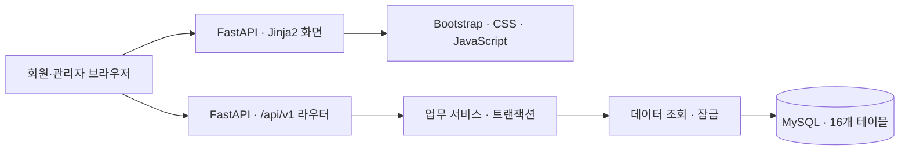

# 기차 예약 및 승차권 관리 시스템 설계서

데이터베이스설계 · 7분반 · 2팀 · 작성일 2026-11-06

## 1. 프로젝트 목적과 범위

회원이 출발역·도착역·승차역 출발일·인원으로 직통 운행을 검색하고,
좌석 예약, 시연용 결제, 발권, 승차권별 취소·환불을 처리하는 웹 시스템이다.
관리자는 역·노선·열차·좌석·시간표·운임 및 탑승 확인을 관리한다.
동일 운행의 같은 좌석은 이용 구간이 겹치지 않을 때 다시 판매할 수 있다.

한 예약은 같은 운행·승하차 구간의 여러 좌석을 묶는다.
일정 변경은 기존 승차권 취소 후 재예약으로 처리한다.
전체 요구사항과 팀원 역할은 [01-requirements.md](01-requirements.md)를 따른다.

## 2. 개발 환경과 프레임워크

| 항목 | 사용 기술 | 역할 |
| --- | --- | --- |
| 개발 언어 | Python 3.11 이상, HTML, CSS, JavaScript | 서버와 웹 화면 개발 |
| **서버 프레임워크** | **FastAPI** | HTTP API, 요청 검증, 의존성 주입, OpenAPI 생성 |
| 템플릿 엔진 | Jinja2 | 서버에서 HTML 렌더링 |
| UI | Bootstrap 5 | 화면 구성과 스타일 |
| ASGI 서버 | Uvicorn | 개발 서버 실행 |
| 데이터 접근 | SQLAlchemy, PyMySQL | DB 세션과 SQL 실행, 향후 ORM 매핑 |
| DBMS | MySQL | 관계형 데이터와 트랜잭션 관리 |
| 개발 DB | Docker Compose의 MySQL 8.4 | 팀 공통 개발 환경 |
| 검증 도구 | pytest, HTTPX TestClient, Ruff | 동작·문법·코드 형식 확인 |
| 협업 | Git, GitHub, GitHub Actions | 버전 관리, PR, CI |

프레임워크는 **FastAPI 사용**으로 확정한다. 이 프로젝트의 환경설정과 의존성도 이 기준을 따른다.
MySQL 초기 DDL은 8.0.16 이상을 대상으로 한다.

## 3. 시스템 구성

위 구성은 목표 설계다. 현재 앱은 홈 화면·상태 확인·회원 및 인증 API 6개를 구현했고,
ORM 16개, 회원 서비스·저장소, 공통 인증과 오류를 구현했다. 나머지 업무는 기능별 라우터에서 개발한다.
상세 책임 분리는 [02-architecture.md](02-architecture.md)를 참고한다.

| 계층 | 책임 | 주요 경로 |
| --- | --- | --- |
| 화면 | HTML 렌더링, 사용자 입력, API 결과 표시 | `app/templates`, `app/static` |
| API | 요청·응답 변환과 인증 의존성 적용 | `app/api`, `app/schemas` |
| 서비스 | 구간 검증, 금액 계산, 상태 전이, 트랜잭션 | `app/services` |
| 데이터 접근 | SQL·잠금 조회, ORM 매핑 | `app/repositories`, `app/models` |
| 공통 설정 | 환경변수와 DB 세션 주입 | `app/core`, `app/db` |

동기 SQLAlchemy/PyMySQL을 호출하는 라우트는 일반 `def`로 작성한다.
요청마다 세션 하나를 공급하고 서비스가 commit·rollback 경계를 관리한다.

## 4. 데이터베이스 설계

| 업무 | 테이블 |
| --- | --- |
| 회원 | `users` |
| 기준정보 | `train_types`, `stations`, `trains`, `seats`, `routes`, `route_stops` |
| 운행·운임 | `runs`, `run_stops`, `fares` |
| 예약·승차권·구간 점유 | `reservations`, `tickets`, `seat_occupancies` |
| 결제·환불 | `payments`, `refunds` |
| 탑승 확인 | `boarding_checks` |

[첨부 ERD](sources/ERD-reference.png)의 16개 엔터티를 기준으로 한다.
열차종류코드는 train_types에서 관리하고 열차와 구간운임이 FK로 참조한다.
운행방향은 runs에 저장하며 routes에는 두지 않는다.
좌석점유는 (운행ID, 좌석ID, 구간시작순서)를 복합 PK로 사용한다.
16개 테이블의 필드·FK·CHECK·UNIQUE 정의는 `db/001_schema.sql`에 있다.
관계도는 [ERD.mmd](ERD.mmd), 설계 근거와 잠금 규칙은 [03-database.md](03-database.md)를 따른다.
SQL은 신규 개발 DB 초기화용이며 기존 공유 DB 변경에는 후속 마이그레이션을 추가한다.
이전 14개 테이블 스키마의 변경안은 [마이그레이션 안내](../db/migrations/README.md)에 있다.
그림 밖의 보안·기한·금액·이력 관리 필드는 [DB 설계](03-database.md)에 별도로 구분한다.

## 5. 핵심 업무 처리

### 검색과 예약

1. 선택한 승차역에서 출발하는 한국시간 날짜와 출발시각을 기준으로 운행을 찾는다.
2. 출발역 다음에 도착역이 정차하는 판매 가능 운행만 선택한다.
3. 구간 전체에서 사용할 수 있는 동일 좌석과 해당 등급 운임을 확인한다.
4. 예약 시 열차 행을 잠근 뒤 상태와 좌석 점유를 다시 확인한다.
5. 예약·승차권과 모든 이용 구간의 좌석점유를 한 트랜잭션으로 생성한다.

구간을 `[승차순서, 하차순서)`로 비교한다. 기존 구간 `[x, y)`와 신규 구간 `[b, a)`는
`x < a AND b < y`일 때 충돌한다. A→B와 B→C는 같은 좌석에 연속 판매할 수 있다.
동시 요청은 단순 사전 조회로 막지 않고 [DB 잠금 규칙](03-database.md)을 함께 적용한다.
각 좌석의 b부터 a-1까지 점유를 INSERT하며 복합 PK가 하나라도 충돌하면 예약 전체를 rollback한다.
취소·만료는 승차권 상태 변경과 점유 삭제를 함께 처리하고 결제 성공 시에는 점유를 유지한다.

### 결제와 발권

결제는 실제 PG와 연동하지 않는 시연용이다. 카드번호 등 실제 결제정보를 받지 않는다.
서버가 승차권 확정금액의 합계를 계산하고, 결제기한·출발시각·예약 상태를 재검증한다.
성공 결제 기록, 예약의 결제완료 변경, 승차권 발권은 한 트랜잭션으로 처리한다.
멱등키와 예약당 성공 결제 1건 제약으로 중복 결제·발권을 방지한다.

### 취소·환불과 탑승

미결제 예약 취소는 좌석을 해제하고 환불을 생성하지 않는다.
발권 후에는 승차권 단위 부분취소를 허용한다. 취소 상태와 환불 처리 결과는 별도로 저장한다.
환불에 실패해도 취소 승차권은 사용 불가 상태를 유지하며, 실패 환불은 기존 기록으로 재시도한다.
유효한 발권 승차권만 관리자가 탑승 확인할 수 있고 같은 승차권은 한 번만 확인할 수 있다.

상태값·경계조건은 [05-business-rules.md](05-business-rules.md)를 따른다.
예약 10분, 1~9명, 출발 전 전액 환불 등의 세부 정책은 원문에 없는 추가 설계안이며
[10-decisions.md](10-decisions.md)에 따로 표시했다.

## 6. API와 권한

API 기본 경로는 `/api/v1`, 실행 중인 서버의 Swagger UI는 `/docs`다.

| 분류 | 주요 경로 | 권한 |
| --- | --- | --- |
| 상태 확인 | `GET /health` | 공개, 현재 구현 |
| 회원 | `/auth/*`, `/users/me` | 공개 또는 본인 |
| 운행 조회 | `/stations`, `/runs`, `/runs/{run_id}/seats` | 공개 또는 로그인 회원 |
| 예약·결제 | `/reservations`, `/reservations/{reservation_id}/payments` | 본인 |
| 취소·환불 | `/reservations/{reservation_id}/ticket-cancellations`, `/refunds` | 본인 |
| 운영 | `/admin/*` | 관리자 |

health와 회원·인증 6개 API는 구현했으며 그 외 업무 API는 예정 계약이다.
전체 62개 작업의 요청·응답·오류·필터는 [04-api.md](04-api.md)와 [openapi.json](openapi.json)에 있다.
좌석점유는 서비스 내부에서만 변경하며 클라이언트가 직접 생성·삭제하는 API는 제공하지 않는다.
인증은 HS256 JWT와 회원별 token_version으로 구현했다. 공통 비밀키 설정과 실제 MySQL 검증이 필요하다.
예약·금액·권한 등 서버가 결정할 값은 클라이언트 입력을 그대로 신뢰하지 않는다.

## 7. 개발·협업·검증

| 문서·파일 | 사용 목적 |
| --- | --- |
| [06-development.md](06-development.md) | 계층별 책임, 코드 규칙, API·DB 변경 절차 |
| [07-git-workflow.md](07-git-workflow.md) | 브랜치, pull·push, 충돌, commit, PR·리뷰·병합 |
| [08-test-plan.md](08-test-plan.md) | 권한·동시성·결제·환불·자정 경계 인수 기준 |
| [09-roadmap.md](09-roadmap.md) | 팀원별 구현 순서와 완료 조건 |
| [12-deployment.md](12-deployment.md) | Docker 이미지·웹+DB 실행·Render Docker 배포 |
| `../Dockerfile`, `../compose.yaml` | Python 3.12 웹 이미지와 로컬 웹·MySQL 컨테이너 |
| `../.github/pull_request_template.md` | PR 본문 양식 |
| `../.github/ISSUE_TEMPLATE` | 기능·버그 이슈 양식 |
| `../.github/workflows/ci.yml` | Python·MySQL·API 명세·프론트 검사와 Docker 빌드·HTTP 검증 |

기능 브랜치에서 개발하고 `develop`으로 PR을 보낸다. CI 통과와 최신 `develop` 반영 후 작성자가 병합할 수 있다.
리뷰 요청과 다른 팀원의 승인은 선택 사항이다.
제출 시에는 `develop`에서 `main`으로 PR을 보낸다. 원격 브랜치 보호 설정은 저장소 관리자가 적용한다.

## 8. 근거 문서

- [제안서](https://docs.google.com/document/d/1eDCdw0_zxvUQLHEWRPFBUaleSqtQ9oj-/edit)
- [업무분석서](https://docs.google.com/document/d/1lst6UsPt1-7TQZISew9ixknkWA5f3ZE3m_V1OhgDxf0/edit?tab=t.0)
- [후속 첨부 ERD — DB 구조 기준](sources/ERD-reference.png)
- [FastAPI 템플릿 공식 문서](https://fastapi.tiangolo.com/advanced/templates/)
- [FastAPI 동기·비동기 함수 공식 문서](https://fastapi.tiangolo.com/async/)

원문 사본은 [sources/README.md](sources/README.md)에서 확인한다.
